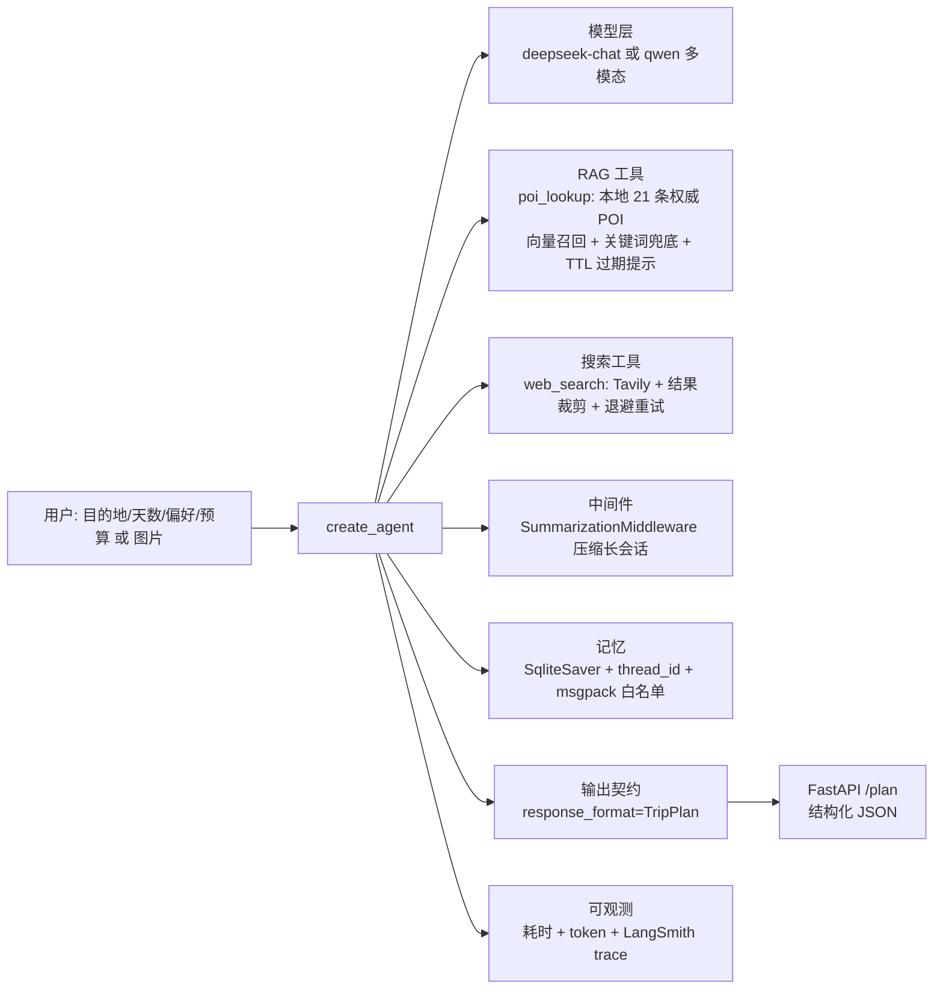

# AI Travel · 旅行规划 Agent

> 说出目的地、天数和偏好（也可以直接甩一张图），Agent 先查**本地权威 POI 知识库**，不足时再联网检索，
> 最后输出**结构化**行程方案：每天的片区、景点顺序、停留时长、门票、通勤、人均花费、风险提示与参考来源。

LangChain 1.x / LangGraph 实现：RAG + 工具重试降级 + 会话记忆 + 上下文压缩 + 结构化输出契约 +
可复现的评测规则 + HTTP 服务层 + 全链路实测数据。

---

## 1. 架构



## 2. 快速开始

```powershell
copy .env.example .env        # 填 DEEPSEEK_API_KEY 与 TAVILY_API_KEY；.env 必须纯 ASCII
uv sync

python main.py 杭州 3天 2人 喜欢人文历史 不吃辣 人均预算1500
python main.py --session trip1 第二天改成雨天方案      # 复用会话
python main.py --image 截图.png 这个景点值得去吗        # 需 TRAVEL_MODEL=qwen3.5-plus

python tests/test_offline.py   # 16 项，不联网、不花 token
python tests/test_service.py   # 5 项，TestClient 直打接口
python evals/run_eval.py --dry-run
python evals/run_eval.py       # 6 条端到端用例（真实调用）

uvicorn service:app --host 127.0.0.1 --port 8000      # HTTP 服务
curl -X POST http://127.0.0.1:8000/plan -H "Content-Type: application/json" ^
     -d "{\"request\":\"西安 1天 想看兵马俑 人均预算400\"}"

$env:PYTHONUTF8 = "1"; langgraph dev                  # Studio 可视化调试
```

## 3. 目录结构

```
travel/
  config.py        环境变量校验：缺 key 直接抛可读错误，不静默回退
  schemas.py       输出契约 Spot / DayPlan / TripPlan
  rag.py           本地 POI 知识库：向量召回 + 关键词兜底 + 相似度阈值 + TTL
  tools.py         Tavily 封装：结果裁剪 + 退避重试 + 失败降级
  multimodal.py    图片输入：格式/大小校验 + base64 content block
  prompts.py       提示词集中管理，便于版本对比
  graph.py         Agent 组装 + plan_trip()
  eval.py          行程质量规则（纯函数）
  observability.py 耗时与 token 统计、成本估算
data/pois.jsonl    21 条 POI 语料（含 verified_at 与来源）
main.py            CLI 入口（--session / --image）
service.py         FastAPI：/health /plan
evals/             端到端用例与评测脚本
tests/             离线单测 + 服务层测试
resources/         SQLite 会话库、向量缓存（已 gitignore）
notebooks/         课程练习，与本项目无关
legacy/            v1 单文件版本，仅作演进记录
```

## 4. 关键设计决策

| 决策 | 做法 | 为什么 |
|---|---|---|
| **RAG 优先于联网搜索** | `poi_lookup` 先查本地权威库（门票、开放时间、闭馆日、预约入口），命中且未过期就不再为同一事实搜索 | 攻略类网页信息噪音大、易过期；权威字段本地化后既准又稳，也避免模型满篇「需出行前核实」 |
| **相似度阈值按语料标定** | 实测真实命中 top1 落在 0.60-0.70、跑题查询落在 0.41-0.48，据此取 `MIN_SCORE_EMBEDDING = 0.55` | 阈值太松会把无关条目喂给模型，模型以为查到了就不再调用 web_search——这是最难发现的一类错误 |
| **embedding 失败自动降级** | 语义召回不可用时自动切中文 bigram 关键词打分，功能不中断且可离线单测 | 不因为一个外部接口挂掉就没法跑；降级路径的局限（拦不住词面重合的跑题查询）在代码和测试里都写明 |
| **知识库带 TTL** | 每条记录 `verified_at`，超 180 天在工具输出里追加「可能过期，需 web_search 复核」 | 门票和闭馆日会变；把「数据新鲜度」变成模型能看到的信号，而不是假装数据库永远正确 |
| **工具输出必须紧凑** | POI 一条一行、字段截断；搜索结果只留「标题 \| 链接 + 220 字摘要」 | 工具输出直接进上下文，啰嗦的输出是成本大头 |
| **结构化输出契约** | `response_format=TripPlan`，`spots.min_length=2`、`minutes` 限 15-600 | 前端可直接消费；把「每天至少 2 个点」这类要求写进 schema 比写进 prompt 可靠 |
| **工具重试与降级** | 退避重试 + 总时长上限；失败返回「请基于常识规划并把 references 留空」 | 工具异常不该让链路崩掉，同时保住「有没有外部来源」这个信号 |
| **启动即校验** | `require_env()` 按 `TRAVEL_MODEL` 只校验真正需要的 key | `base_url=None` 会让 SDK 静默回退到 `api.openai.com`，46 秒后才抛 Connection error |
| **评测 thread 隔离** | 每次评测用 `eval-<run_id>-<n>` 作为 thread_id | `SqliteSaver` 按 thread 存状态，复用 id 会让第二次评测在上一轮对话后面继续问，结果不可复现 |
| **质量可自动判定** | `evaluate_report()` 校验天数一致、天序连续、单日时长上限、跨天重复、预算自相矛盾、链接合法、**天数与预算是否符合用户要求** | 把「行程靠不靠谱」从主观阅读变成可回归的断言 |
| **成本可见** | `RunStats` 累加 `usage_metadata`，`cost_yuan()` 按单价估算 | 说不出 token 和延迟，就谈不上优化 |

## 5. 实测结果

| 项目 | 结果 |
| --- | --- |
| 离线单测 | **16/16** 通过（不联网、不花 token） |
| 服务层测试 | **5/5** 通过（TestClient，含 422/502/503 分支） |
| 端到端评测 | **6/6 = 100%**（天数、预算上限、来源三项硬约束） |
| 多模态实测 | qwen3.5-plus 正确识别截图内容并判定「非旅游场景」，13.5 s / 2,364 token |
| HTTP 实测 | `POST /plan` 200，27.5 s，返回结构化 JSON（4 景点、8 条风险、5 条来源） |

### 成本这条线是真实权衡，不是「RAG 一定更省」

| 配置 | 6 条用例累计 token |
| --- | --- |
| 只有 web_search | 70,982 |
| 加 RAG（输出未压缩） | 148,801 |
| 加 RAG + 压缩工具输出 + top_k 降到 2 | **129,107** |

加 RAG 让 token 涨了约 82%，换来的是权威门票/开放时间/闭馆日/预约入口，以及不再满篇「需核实」。压缩工具输出把 148,801 降回 129,107（−13%）。**下一步优化方向明确**：`web_search` 的 `max_results` 从 5 降到 3、`poi_lookup` 每城市合并成一次查询，预计可再降 20-30%，但需要用评测确认质量不掉——不能只优化成本不看质量。

## 6. 路线图

- [x] 结构化输出契约 · 工具裁剪与重试降级 · 启动校验 · 会话记忆 · 上下文压缩 · 质量规则 · 评测脚本 · token/耗时统计
- [x] **RAG**：本地 POI 知识库 + 向量/关键词混合召回 + TTL + 相似度阈值标定
- [x] **服务化**：FastAPI `/plan`、`/health`，替掉临时隧道域名
- [x] **多模态输入**：`--image` 走标准 image content block，并校验模型能力
- [ ] **P3** 真实天气/交通数据工具；Prompt 版本 A/B 与 LangSmith Dataset 回归；失败看板；日志脱敏；把 POI 语料换成定期抓取的权威数据源（当前 21 条为演示语料，字段格式与 TTL 机制是通用的）

## 7. 踩坑记录（真实排障过程）

1. **`langgraph dev` 启动即崩** `UnicodeDecodeError: 'gbk' codec can't decode byte 0x94`：包内 `validation.py` 用 `open()` 读 `openapi.json` **没指定 encoding**，中文 Windows 默认 GBK。定位方式：读源码找到 `open()`，再扫出同包 3 处同类隐患 → 别手改单个文件，用 `PYTHONUTF8=1` 一次性解决。
2. **`.env` 里的中文注释导致同类崩溃**：`langgraph_api/cli.py` 直接 `DotEnv(path).dict()`，这条路径不指定编码；而 `load_dotenv()` 走的是默认 UTF-8 路径。**同一份文件、两条代码路径，一条能读一条崩** → 规约：`.env` 永远只写 ASCII。
3. **46 秒后 `OpenAIConnectionError`**，底层 `WinError 10061`：`os.getenv("DASHSCOPE_BASE_URL")` 返回 `None`，OpenAI SDK **静默回退**到 `api.openai.com`。定位方式：打印 `client.base_url` 对比预期。
4. **包已安装但 notebook 里 `ModuleNotFoundError`**：kernel 早于 `uv add` 启动。用 `importlib.util.find_spec()` 自检并打印 `sys.executable` 判断 kernel 用的是不是 `.venv`。
5. **`uv add` 报 `os error 5 拒绝访问`**：不是权限问题，是运行中的 kernel 把 `_zmq.pyd` 映射进内存导致文件无法替换。处置顺序：断开 kernel → 停后台服务 → 再装。
6. **传递依赖被直接 import**（`langgraph`/`langchain-core`/`pydantic`）：上游一旦不再依赖就会突然 `ImportError` → 在 `pyproject.toml` 显式声明。
7. **`load_dotenv()` 依赖当前工作目录**：从别的目录启动就读不到配置 → 按 `Path(__file__).parent.parent` 定位项目根。
8. **评测不可复现：`thread_id` 复用污染状态**：第二次跑评测第 6 条用例报「未按 schema 返回」，单独重跑却正常——`SqliteSaver` 按 thread 存状态，固定 `eval-<n>` 等于在上一轮完整对话后面继续问 → 每次评测加 `run_id` 前缀。
9. **checkpointer 未注册自定义类型**：`Deserializing unregistered type travel.schemas.TripPlan from checkpoint`，未来版本会直接拒绝 → `JsonPlusSerializer(allowed_msgpack_modules=[...])` 注入 `SqliteSaver(serde=...)`。
10. **百炼 embedding 有 batch 上限**：一次传 21 条文本直接 `400 InternalError.Algo.InvalidParameter: batch size should not be larger than 10` → 分批请求；同时验证了降级路径真的会兜住（异常被捕获、打印原因、切关键词召回）。
11. **RAG 阈值不能拍脑袋**：最初用固定 0.28，结果「火星基地」仍匹配到「大熊猫繁育研究基地」→ 实测分数分布后把阈值提到 0.55，跑题查询才干净拒绝；关键词降级路径的局限单独用测试写明。

## 8. 已知风险

- `data/pois.jsonl` 是**演示语料**，字段格式与 TTL 机制通用，但真实上线必须换成定期抓取的权威数据源。
- Windows **Smart App Control** 会拦截未签名扩展（本机实测拦过 `uuid_utils/_uuid_utils.pyd`，重试即通过）。
- `smith.langchain.com` / `api.tavily.com` 是境外服务，国内网络可能需要代理。
- `.env` 中曾长期存放明文云 AccessKey；`.env` 已 gitignore，但 AK/SK 权限远大于模型 key，不应明文长期存放。