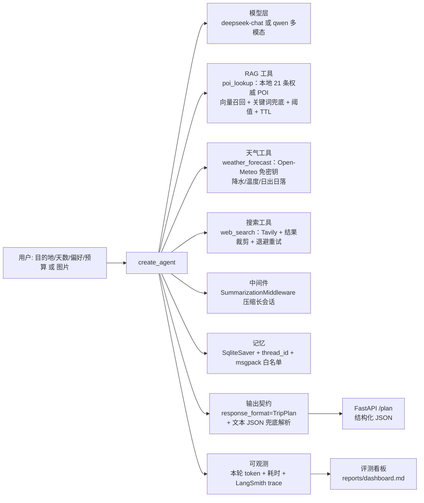

# AI Travel · 旅行规划 Agent

> 说出目的地、天数和偏好（也可以直接甩一张图），Agent 依次查**本地权威 POI 知识库**、**实时天气**，
> 不足时才联网检索，最后输出**结构化**行程方案：每天的片区、景点顺序、停留时长、门票、通勤、人均花费、风险与来源。

LangChain 1.x / LangGraph 实现：RAG + 实时天气 + 工具重试降级 + 会话记忆 + 上下文压缩 + 结构化输出契约
+ 可复现评测与 Prompt A/B + FastAPI 服务层 + CI。

 

## 1. 架构



## 2. 快速开始

```powershell
copy .env.example .env        # 填 DEEPSEEK_API_KEY 与 TAVILY_API_KEY；.env 必须纯 ASCII
uv sync

python main.py 杭州 3天 2人 喜欢人文历史 不吃辣 人均预算1500
python main.py --session trip1 第二天改成雨天方案      # 复用会话
python main.py --image 截图.png 这个景点值得去吗        # 需 TRAVEL_MODEL=qwen3.5-plus

python tests/test_offline.py   # 17 项，不联网（需要联网的子项自动跳过）
python tests/test_service.py   # 6 项，TestClient 直打接口
python evals/run_eval.py --dry-run
python evals/run_eval.py --record          # 端到端评测并写入看板
python evals/ab_test.py --limit 3 --record # Prompt A/B 对比
python evals/report.py                       # 渲染 reports/dashboard.md

uvicorn service:app --host 127.0.0.1 --port 8000
$env:PYTHONUTF8 = "1"; langgraph dev         # Studio 可视化调试
```

## 3. 目录结构

```
travel/
  config.py        环境变量校验：缺 key 直接抛可读错误，不静默回退
  schemas.py       输出契约 Spot / DayPlan / TripPlan
  rag.py           本地 POI 知识库：向量召回 + 关键词兜底 + 相似度阈值 + TTL
  weather.py       实时天气（Open-Meteo，免密钥）：降水/温度/日出日落 + 城市坐标缓存
  tools.py         Tavily 封装：结果裁剪 + 退避重试 + 失败降级
  multimodal.py    图片输入：格式大小校验 + base64 content block
  prompts.py       v1/v2 两版提示词，支持 A/B
  graph.py         build_agent() + plan_trip()（无导入副作用）
  studio.py        langgraph dev 专用入口（唯一保留「导入即建图」的地方）
  eval.py          行程质量规则（纯函数）
  observability.py 本轮 token 与耗时统计、成本估算
data/pois.jsonl    21 条 POI 语料（含 verified_at 与来源）
main.py            CLI（--session / --image）
service.py         FastAPI：/health /plan，可选 X-Service-Token
evals/             用例、评测、A/B、看板数据
reports/           history.jsonl + dashboard.md（评测趋势与失败分布）
tests/             离线单测 + 服务层测试
.github/workflows  CI：无密钥环境跑离线子集
resources/         SQLite 会话库、向量缓存（已 gitignore）
notebooks/         课程练习，与本项目无关
legacy/            v1 单文件版本，仅作演进记录
```

## 4. 关键设计决策

| 决策 | 做法 | 为什么 |
|---|---|---|
| **RAG 优先于联网搜索** | `poi_lookup` 先查本地权威库；命中且未过期就不再为同一事实搜索 | 攻略网页噪音大、易过期；权威字段本地化后既准又稳 |
| **相似度阈值按语料标定** | 实测真实命中 top1 落在 0.60-0.70、跑题查询 0.41-0.48，取 `0.55` | 阈值太松会把无关条目喂给模型，模型以为查到了就不再联网——最难发现的一类错误 |
| **embedding 失败自动降级** | 语义召回不可用时切中文 bigram 关键词打分 | 不因外部接口挂掉就不可用；降级路径的局限（拦不住词面重合）在代码与测试里写明 |
| **知识库带 TTL** | 每条 `verified_at`，超 180 天在工具输出里追加「可能过期，需复核」 | 门票和闭馆日会变；把数据新鲜度变成模型能看到的信号 |
| **实时天气独立成工具** | Open-Meteo（免密钥）给降水/温度/日出日落，并提示室内备选 | 天气决定行程可行性，不能靠模型按季节猜 |
| **结构化工具有两级兜底** | 没调用结构化工具时先从文本解析 JSON（花括号配平扫描），再在同一 thread 提醒一次 | 工具越多、提示词越长，模型越容易只回文本；A/B 实测就是这样暴露的 |
| **工具输出必须紧凑** | POI 一条一行并截断字段；搜索只留「标题 \| 链接 + 220 字摘要」，`max_results` 5→3 | 工具输出直接进上下文，啰嗦的输出就是成本 |
| **启动即校验** | `require_env()` 按 `TRAVEL_MODEL` 只校验必需 key | `base_url=None` 会让 SDK 静默回退到 `api.openai.com`，46 秒后才抛 Connection error |
| **无导入副作用** | `graph.py` 只导出工厂函数；「导入即建图」隔离在 `studio.py` | 否则 `uvicorn service:app` 在缺密钥时启动就炸，`/health` 也来不及自检 |
| **token 按本轮切片统计** | 用 `get_state()` 先取历史长度，只统计新增消息 | 多轮会话若按整个 thread 统计，单次成本会被历史虚报（实测同一请求 21k → 7k） |
| **评测 thread 隔离 + 重复采样** | thread 带 `run_id`；重要结论跑 3 轮 | `SqliteSaver` 按 thread 存状态；LLM 单次结果不可信 |
| **质量可自动判定** | `evaluate_report()` 校验天数、天序、单日时长、跨天重复、预算自洽、链接合法、是否符合用户要求 | 把「行程靠不靠谱」变成可回归的断言 |

## 5. 实测结果

| 项目 | 结果 |
| --- | --- |
| 离线单测 | **17/17**（不联网；需联网子项在无密钥环境自动跳过，CI 可跑） |
| 服务层测试 | **6/6**（TestClient，含 401/422/502/503 分支） |
| 端到端评测 | **6/6 = 100%**，累计 78,346 token / 149,855 ms（平均 24.9 s/条） |
| 可靠性重复采样 | 同一组 3 条用例跑 3 轮：**9/9 通过** |
| 多模态实测 | qwen3.5-plus 正确识别截图内容并判定「非旅游场景」，13.5 s / 2,364 token |
| HTTP 实测 | `POST /plan` 200：16.5 s，本轮 6,952 + 1,331 token，6 条风险、3 条来源 |

### 成本演进（同样 6 条用例）

| 配置 | 累计 token | 说明 |
| --- | --- | --- |
| 只有 web_search | 70,982 | 基线，但满篇「需出行前核实」 |
| 加 RAG（输出未压缩） | 148,801 | **RAG 一开始让成本涨了 107%** |
| 压缩工具输出 + `top_k` 3→2 | 110,901 | −25% |
| 合并 POI 查询 + `max_results` 5→3 + 天气工具 | **78,346** | 只比基线贵 10%，却多了权威字段与实时天气 |

### Prompt A/B（3 条用例）

| 版本 | 通过率 | 平均 token | 平均耗时 |
| --- | --- | --- | --- |
| v1（只联网搜索） | 100% | 28,212 | 53,109 ms |
| v2（RAG+天气，兜底前） | 67% | 13,709 | 30,134 ms |
| v2（RAG+天气，兜底后） | 100% | 19,378 | 34,058 ms |

v2 一开始**通过率反而掉了 33%**：工具变多后模型偶尔只回文本、不调结构化工具。加两级兜底后恢复 100%，同时 token 比 v1 省 31%、耗时少 36%。**如果没有 A/B，这个退化会被成本下降掩盖掉。**

## 6. 路线图

- [x] 结构化输出契约 · 工具裁剪与重试降级 · 启动校验 · 会话记忆 · 上下文压缩 · 质量规则 · 评测与 A/B · 看板 · token/耗时统计
- [x] RAG：本地 POI + 混合召回 + TTL + 阈值标定
- [x] 实时天气工具（免密钥）
- [x] 服务化：FastAPI `/plan` `/health` + 可选 token 鉴权
- [x] 多模态输入 `--image`
- [x] CI（离线测试子集）
- [ ] **P3** 交通工具/真实 POI 数据源定期抓取；失败看板接 LangSmith Dataset 做长期回归；日志脱敏与结构化；并发批量评测

## 7. 踩坑记录（真实排障过程）

1. **`langgraph dev` 启动即崩** `UnicodeDecodeError: 'gbk' codec…`：包内 `open()` 读 `openapi.json` 没指定 encoding，中文 Windows 默认 GBK。定位：读源码找到 `open()`，扫出同包 3 处同类隐患 → 用 `PYTHONUTF8=1` 一次性解决，不手改包文件。
2. **`.env` 里的中文注释导致同类崩溃**：`langgraph_api/cli.py` 直接 `DotEnv(path).dict()` 走的是不指定编码的路径，而 `load_dotenv()` 走 UTF-8 路径。**同一文件、两条代码路径，一条能读一条崩** → 规约：`.env` 永远只写 ASCII。
3. **46 秒后 `OpenAIConnectionError`**（底层 `WinError 10061`）：`os.getenv("DASHSCOPE_BASE_URL")` 返回 `None`，SDK **静默回退**到 `api.openai.com`。定位：打印 `client.base_url` 对比预期。
4. **包已装但 notebook `ModuleNotFoundError`**：kernel 早于 `uv add` 启动。用 `importlib.util.find_spec()` 自检并打印 `sys.executable` 判断 kernel 用的是不是 `.venv`。
5. **`uv add` 报 `os error 5 拒绝访问`**：不是权限问题，是运行中的 kernel 把 `_zmq.pyd` 映射进内存导致文件无法替换。
6. **传递依赖被直接 import**（`langgraph`/`langchain-core`/`pydantic`）→ 显式声明。
7. **`load_dotenv()` 依赖当前工作目录** → 按 `Path(__file__).parent.parent` 定位项目根。
8. **评测不可复现：`thread_id` 复用污染状态**：第二次跑评测有用例报「未按 schema 返回」，单独重跑却正常——固定 `eval-<n>` 等于在上一轮完整对话后面继续问 → 每次评测加 `run_id`。
9. **checkpointer 未注册自定义类型**：`Deserializing unregistered type travel.schemas.TripPlan` → `JsonPlusSerializer(allowed_msgpack_modules=[...])` 注入 `SqliteSaver(serde=...)`。
10. **百炼 embedding 有 batch 上限**：一次传 21 条直接 `400 batch size should not be larger than 10` → 分批；同时验证了降级路径确实兜住（捕获异常、打印原因、切关键词召回）。
11. **RAG 阈值不能拍脑袋**：固定 0.28 时「火星基地」照样匹配到「大熊猫繁育研究基地」→ 实测分数分布后提到 0.55 才干净拒绝。
12. **A/B 暴露了 v2 的可靠性退化**（通过率 100%→67%）：工具变多后模型偶尔不调结构化工具 → 两级兜底（文本 JSON 花括号配平解析 + 同 thread 提醒重试）。
13. **自己的看板代码把自己跑崩了**：`summary["cases"]` 是用例数（int），我却当列表遍历取明细 → `TypeError`。真正的字段是 `details`。教训：看板这类「聚合代码」也要有数据契约，不然第一个崩的是自己的工具。
14. **单次评测结论不可信**：LLM 有随机性，同一组用例重复 3 轮才敢下结论；A/B 结论脚本最初用「通过率+token 方向」的简单启发式，把「质量下降但成本下降」误判成「本版没有优势」，改成按质量优先、成本其次并提示样本量限制。

## 8. 已知风险

- `data/pois.jsonl` 是**演示语料**：字段格式、TTL、阈值标定方法通用，但门票与闭馆时间需换成定期抓取的权威源才能上线。
- 评测样本只有 6 条，且判定规则是启发式的（例如预算容差 10%）；扩样与人工抽检仍是必需。
- Windows **Smart App Control** 会拦截未签名扩展（本机实测拦过 `uuid_utils/_uuid_utils.pyd`，重试即通过）。
- `smith.langchain.com` / `api.tavily.com` 是境外服务，国内网络可能需要代理。
- 服务默认只监听 `127.0.0.1`；对外必须设置 `SERVICE_TOKEN`。
- `.env` 中曾长期存放明文云 AccessKey；`.env` 已 gitignore，但 AK/SK 权限远大于模型 key，不应明文长期存放。