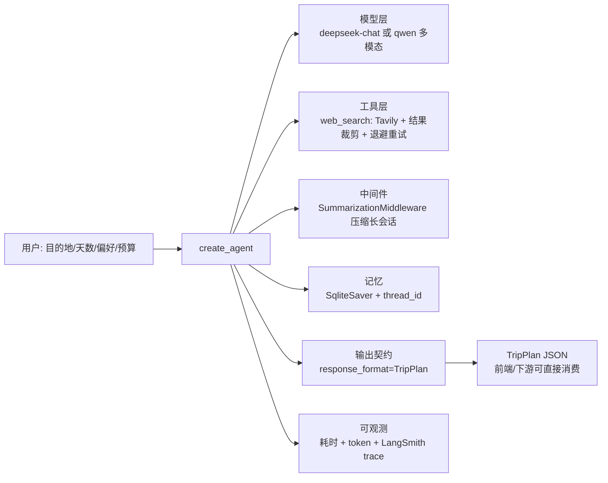

# AI Travel · 旅行规划 Agent

> 说出目的地、天数和偏好，Agent 联网检索真实攻略 → 按天编排行程 → 输出**结构化**方案（含门票、通勤、预算、风险与参考来源）。

LangChain 1.x / LangGraph 实现，带会话记忆、上下文压缩、工具重试降级、结构化输出契约和可复现的评测规则。

---

## 1. 架构



## 2. 快速开始

```powershell
# 1) 配置密钥。注意：.env 必须只含 ASCII 字符，原因见第 7 节第 2 条
copy .env.example .env
#   至少填 DEEPSEEK_API_KEY 与 TAVILY_API_KEY

# 2) 还原依赖（uv 按 uv.lock 精确安装）
uv sync

# 3) 跑一次
python main.py 杭州 3天 2人 喜欢人文历史 不吃辣 人均预算1500

# 复用同一会话，验证记忆（可追问「第二天能不能改成雨天方案」）
python main.py --session trip1 杭州 3天

# 离线测试：不联网、不花 token
python tests/test_offline.py

# 端到端评测（真实调用模型与搜索）
python evals/run_eval.py --limit 2
```

在 LangSmith Studio 里可视化调试：

```powershell
$env:PYTHONUTF8 = "1"      # 解决中文 Windows 的 GBK 编码崩溃
langgraph dev             # 图定义见 langgraph.json -> travel/graph.py:agent
```

## 3. 目录结构

```
travel/
  config.py        环境变量校验：缺 key 直接抛可读错误，不静默回退
  schemas.py       输出契约 Spot / DayPlan / TripPlan
  tools.py         Tavily 封装：结果裁剪 + 退避重试 + 失败降级
  prompts.py       提示词集中管理，便于版本对比
  graph.py         Agent 组装 + plan_trip() 调用封装
  eval.py          行程质量规则（纯函数，可离线测）
  observability.py 耗时与 token 统计、成本估算
main.py            CLI 入口
evals/             端到端用例与评测脚本
tests/             离线单元测试
resources/         SQLite 会话库（已 gitignore）
notebooks/        课程练习（2.1~2.6 与 OpenAI），与本项目无关
scripts/check_keys.py   三个 key 的连通性冒烟测试
legacy/          v1 单文件版本，仅作演进记录
```

## 4. 关键设计决策

| 决策 | 做法 | 为什么 |
|---|---|---|
| **结构化输出契约** | `response_format=TripPlan`，`spots` 有 `min_length=2`、`minutes` 限 15-600 | 自由文本前端没法消费；把「每天至少 2 个点、时长合理」这类要求写进 schema，比写在 prompt 里可靠 |
| **工具返回值裁剪** | `format_search_results()` 只留 `标题 \| 链接 + 220 字摘要`，丢掉 `images/raw_content` | Tavily 原始 dict 很大，整包进上下文既烧 token 又稀释注意力 |
| **工具重试与降级** | `search_with_retry()` 退避重试、受总时长上限约束；失败时返回「请基于常识作答并把 references 留空」 | 工具异常不该让整条链路崩掉；同时保证「有没有外部来源」这个信号不被丢失 |
| **启动即校验** | `require_env()` 集中校验，按 `TRAVEL_MODEL` 只校验真正需要的 key | 见第 7 节第 3 条：`base_url=None` 会让 SDK 静默退回 `api.openai.com`，46 秒后才抛 Connection error |
| **会话记忆** | `SqliteSaver` + `thread_id`，`--session` 复用 | 多轮改方案需要状态；落盘后重启进程仍在 |
| **长会话压缩** | `SummarizationMiddleware(trigger=20, keep=5)` | 防止超出上下文窗口，同时保留最近几轮细节 |
| **质量可自动判定** | `evaluate_report()` 检查天数一致、天序连续、单日时长上限、跨天景点重复、预算与逐日花费是否自相矛盾、链接合法性 | 把「这趟行程靠不靠谱」从主观阅读变成可回归的断言 |
| **成本可见** | `RunStats` 累加 `usage_metadata`，`cost_yuan()` 按单价估算 | 说不出 token 和延迟，就谈不上优化 |
| **模型分级** | `TRAVEL_MODEL` 切换：纯文本用 deepseek，需要读图（行程单/截图）切 qwen 多模态 | 能力与成本的权衡，能讲清为什么这么分 |

## 5. 测试与评测

**离线单测**（`python tests/test_offline.py`，当前 **8/8 通过**，全程不联网）覆盖：结果裁剪是否丢掉重字段与脏数据、limit 边界、重试是否在超时后停止并正确降级、成功时的命中数统计、`evaluate_report` 对合法行程返回空、对 7 类真实缺陷分别报出对应问题、token 累加与成本计算、缺 key 与 qwen 模式强制校验 `DASHSCOPE_BASE_URL`。

**端到端评测**：`evals/cases.jsonl` 6 条用例（杭州/成都/西安/厦门/北京/大理，覆盖人文、亲子、预算紧、老人同行、自驾摄影等约束），`python evals/run_eval.py` 输出通过率、每条失败原因、累计 token 与耗时；逐条 trace 可在 LangSmith 按 `session=eval-<n>` 过滤。

### 实测结果

| 项目 | 结果 |
| --- | --- |
| 离线单测 | 9/9 通过（不联网、不花 token） |
| 端到端评测 | 6/6 = 100% 通过（含天数、预算上限、来源三项硬约束） |
| 累计开销 | 70,982 token / 161 s（6 条用例，deepseek-chat） |
| 成本优化 | 提示词限制「最多检索 3 次」后，同一套用例从 339,146 token 降到 70,982 token，**降 79%** |

评测规则不是走过场：加约束之前，「北京 5 天」被排成 3 天、预算超上限这类问题是**测不出来**的。

## 6. 路线图

- [x] 结构化输出契约 · 工具裁剪与重试降级 · 启动校验 · 会话记忆 · 上下文压缩 · 质量规则 · 离线单测 · 评测脚本 · token/耗时统计
- [ ] **P2** RAG：本地 POI 知识库（开放时间/门票/闭馆日）向量检索，Tavily 退化为兜底；FastAPI/Docker 服务化（当前只有 `langgraph dev --tunnel` 的临时域名）；图片输入入口（`TRAVEL_MODEL=qwen*` 已就绪，但 CLI 还没接上传）
- [ ] **P3** 真实天气/交通数据工具、Prompt 版本 A/B、失败看板、日志脱敏、并发批量评测

## 7. 踩坑记录（真实排障过程）

1. **`langgraph dev` 启动即崩** `UnicodeDecodeError: 'gbk' codec can't decode byte 0x94`。根因是包内 `validation.py` 用 `open()` 读 `openapi.json` **没指定 encoding**，中文 Windows 默认 GBK。定位方式：读源码找到 `open()`，再扫出同包 3 处同类隐患 → 结论是别手改单个文件，用 `PYTHONUTF8=1` 一次性解决。
2. **`.env` 里的中文注释导致同类崩溃**。`langgraph_api/cli.py` 直接 `DotEnv(path).dict()`，这条代码路径不指定编码；而 notebook 里的 `load_dotenv()` 走的是默认 UTF-8 路径。**同一份文件、两条代码路径，一条能读一条崩** → 规约：`.env` 永远只写 ASCII。
3. **46 秒后 `OpenAIConnectionError: Connection error`**，底层 `WinError 10061 连接被拒绝`。真因是 `os.getenv("DASHSCOPE_BASE_URL")` 返回 `None`，OpenAI SDK **静默回退**到 `api.openai.com`。定位方式：打印 `client.base_url` 与预期对比。修复：启动时显式校验，并写了单测锁住这个行为。
4. **包已安装但 notebook 里 `ModuleNotFoundError`**：kernel 早于 `uv add` 启动。不是重装能解决的，用 `importlib.util.find_spec()` 自检并打印 `sys.executable`，确认 kernel 用的是不是 `.venv`。
5. **`uv add` 报 `os error 5 拒绝访问`**：不是权限问题，是运行中的 kernel 把 `_zmq.pyd` 映射进内存导致文件无法替换。处置顺序：断开 kernel → 停后台服务 → 再装。
6. **`langgraph` / `langchain-core` / `pydantic` 只是传递依赖却被直接 import**：上游一旦不再依赖就会突然 `ImportError`。修复：在 `pyproject.toml` 显式声明。
7. **评测不可复现：`thread_id` 复用污染状态**。第二次跑评测时第 6 条用例报「未按 schema 返回」，单独重跑却完全正常。根因是 `SqliteSaver` 按 `thread_id` 存状态，而评测固定用 `eval-<n>`——第二次跑等于在上一轮的完整对话后面继续追问。修复：每次评测加 `run_id` 前缀隔离 thread。
8. **checkpointer 未注册自定义类型**。运行时报 `Deserializing unregistered type travel.schemas.TripPlan from checkpoint`，并提示未来版本会直接拒绝。修复：`JsonPlusSerializer(allowed_msgpack_modules=[...])` 通过 `SqliteSaver(conn, serde=...)` 注入。
9. **`load_dotenv()` 依赖当前工作目录**：从别的目录启动就读不到配置。修复：按 `Path(__file__).parent.parent` 定位项目根，并用陌生 cwd 复验。

## 8. 已知风险

- **`.env` 中曾有明文云 AccessKey**：本项目使用 `.env` 且已 gitignore，但 AK/SK 权限远大于模型 key，不应长期明文存放，泄露后需在 RAM 控制台立即禁用并重建。
- Windows **Smart App Control** 会拦截未签名的编译扩展（本机实测拦过 `uuid_utils/_uuid_utils.pyd`，重试即通过）。
- `smith.langchain.com` / `api.tavily.com` 是境外服务，国内网络可能需要代理。
- `langgraph dev --tunnel` 给的 `trycloudflare.com` 域名每次启动都会变，只能用于开发调试。